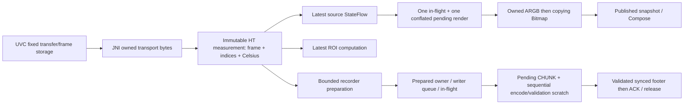

# R4 offline RSS investigation after the 60-second request

## Conclusion and scope

The preserved evidence does **not** establish a leak, a recorder-only RSS increase,
or safe longer recording. It establishes substantial allocation/GC/RSS variation
with the ordinary camera/presentation pipeline even without recording. The
relative Start reference affects the safety predicate, but this does not prove
that either recorded RSS stop was unnecessary.

One redundant display-only matrix copy is removed on an explicitly immutable
module path. Four fresh HotSpot processes reproduce **442384 fewer allocated
bytes per HT-301 render**, with identical ARGB/ranges and unchanged measurement
evidence. This is not a measured Android RSS reduction. The current RSS guard,
78 MiB logical reservation, 32 MiB independent margin, queues, journal, both
complete validations and durable ACK/loss rules remain unchanged.

This work uses preserved evidence and Fedora JVM/Python/Robolectric only. There
was no ADB discovery, phone/camera access, APK installation, emulator, ART or
Actions execution. No physical recording or canonical fixture was generated.
The base is `3d4624836b779fcdabd622cbd0a8f5b2df8fb7ad`; the physically tested
60-second-request code remains `c8d5d5cc1c5154ca3cbf62ab4ad6322d0eb8f23f`.

The [scalar receipt](rss-offline-validation.json) retains exact sampled values,
counter intervals, source hashes and host results. It contains no scene, matrix,
recording, device identifier or private source path. Historical originals,
failed builds and initial/final benchmark rounds remain private and unchanged.

**Native-equivalent temperatures; absolute physical accuracy not yet independently validated.**

## Preserved physical trajectories

Bytes below are exact. A health probe is the input to the safety decision; a later
diagnostic probe is a different instant. Row `elapsed_ns` labels JSON output, not
an atomic timestamp for health, RSS, GC, native allocation and recorder counters.
Nothing between samples is interpolated.

| Attempt | Physically tested code | Start health RSS | Relative limit | Health RSS peak | Later diagnostic RSS peak | Outcome |
|---|---|---:|---:|---:|---:|---|
| [Full first](FIRST_PHYSICAL_ATTEMPT.md) | `0696647` | 318513152 | 452730880 | Unknown | Unknown | One observation; diagnostic serialization failure, no memory rows |
| [Full second](SECOND_PHYSICAL_ATTEMPT.md) | `bd2cfa6` | 297185280 | 431403008 | **440557568** | 448307200 | RSS Stop request at 4.308975303 s; 45 ACK, 2 preparation and 58 writer losses |
| [Analysis 5 Hz / 10 s](ANALYSIS_FIVE_HZ_PHYSICAL.md) | `d1b8c89` | 388730880 | 522948608 | 465272832 | 477184000 | Completed after first Stop request at 10.644236008 s; 54 ACK, no losses |
| [Analysis 5 Hz / 60 s request](ANALYSIS_FIVE_HZ_60S_PHYSICAL.md) | `c8d5d5c` | 301993984 | 436211712 | **493776896** | 499560448 | Intake cutoff at 3.279581138 s; interrupted END, 17 ACK, no losses |

The first Full code is pinned from its original report, not the later callback
diagnostic fix. The initial derived source-plan label was corrected separately;
both derived versions and the explanation are preserved. No original was edited.

The final Analysis health RSS points are exactly
`314155008 → 426303488 → 362545152 → 493776896`. The last point triggers the guard;
the later 499560448-byte diagnostic peak is not its predicate. Health Java occupancy
is `51465216 → 147586048 → 86907904 → 197520384`. Final Java headroom is
70915072 bytes, above the separate runtime 32 MiB margin. This is an RSS stop,
not an OOM or Java-headroom refusal. Four rows do not establish a steady state.

| Attempt | Diagnostic rows / row-anchor span | Allocated counter delta | Freed counter delta | Natural GC count / reported GC-time delta | Diagnostic Java / native-allocator / PSS maxima |
|---|---|---:|---:|---|---|
| Full second | 5 / 4.224516156 s | 960851968 | 859131904 | 4 / 365 ms | 152173568 / 56654192 / 391725056 |
| Analysis 10 | 10 / 9.493188481 s | 993923072 | 1049509888 | 5 / 362 ms | 184650752 / 65942336 / 427072512 |
| Analysis 60 request | 4 / 3.192452232 s | 323055616 | 173768704 | 1 / 50 ms | 202460160 / 66405760 / 449430528 |

These are differences of runtime counters at two sequential observations. They
are not exact recording-wide totals or retained-live bytes. Freed objects may
have been allocated before the interval. A GC counter change does not locate the
collection relative to a health probe or CHUNK. Occupied Java heap includes
uncollected garbage; native allocator bytes exclude some graphics/driver/mappings;
RSS/PSS have different accounting. Do not subtract Java occupancy from RSS and
call the remainder native memory.

Ordinary READY setup before Start lasted approximately 232 s for Analysis 10 and
248.8 s for the 60-second request. These were uncontrolled operator/setup waits,
not matched warmups or a selection of favorable GC instants. Comparable durations
are not established for both Full attempts. The ten-second preview was not watched;
the operator observed the entire later short 3.28-second beginning as responsive.
Neither observation qualifies a minute. Scenes, code, start occupancy, system
availability and GC phase differ; these recordings are not paired experiments.

### Camera/presentation without a recorder

The preserved normal Auto/full-ROI window contains 20 rows and 528 valid frames at
about 25 FPS. Health RSS ranges from 280956928 to **471003136** bytes; diagnostic
RSS reaches 475676672, Java occupancy 185249984 and native allocation 52000224.
Across 20.054834238 s of row anchors, counters report 1456558080 allocated,
1371103232 freed and eight natural collections / 525 ms. Four of 20 observational
110 MiB admission-headroom checks fail. No recorder was created or started.
See [the original live-memory interpretation](PIXEL_LIVE_MEMORY.md).

Four historical, sequential ten-row presentation phases also have no recorder:

| Historical phase | Health RSS maximum | Allocated / freed counter deltas | GC count / time |
|---|---:|---:|---|
| Locked, no ROI | 446967808 | 572563456 / 620945408 | 4 / 256 ms |
| Auto, no ROI | 452050944 | 684490752 / 662261760 | 4 / 224 ms |
| Auto, full ROI | 421072896 | 685408256 / 662257664 | 4 / 231 ms |
| Previously authorized suppressed presentation | 372158464 | 360751104 / 375390208 | 3 / 200 ms |

The phases are short, unpaired with today's candidate and have no independently
pinned commit in the input receipt. Their lower/higher endpoints cannot quantify
the causal cost of ROI, Auto or recording. Suppression is preserved historical
evidence, **not** a new experiment or a proposed way to pass admission.

Existing `dumpsys meminfo` snapshots supply graphics categories missing from the
one-Hz rows: Full-first pre-Start reports Graphics PSS/RSS 120092 KiB; Analysis-10
before/after snapshots report 124568 KiB in both. Analysis-10 total RSS is
483256/422456 KiB at those snapshots, unlike its actual Start/health values. These
unsynchronized observations demonstrate substantial graphics residency, not its
growth during the failed 60-second request or unique Bitmap ownership. No aligned
graphics series, root census or post-natural-GC retained floor is available.

## Ownership and allocation audit



Arrows are references/copies along stages, **not** counts of distinct live owners.
Several displayed roles can alias the same measurement. Coroutine spills or a
consumer can retain a previous bounded owner; only an actual root census can
establish all reachable objects. Existing weak diagnostic history is bounded but
is not such a census.

| Owner/work | Evidence-backed cost or behavior | Unresolved attribution |
|---|---|---|
| UVC/JNI | `transport.cpp` copies into one conflated latest vector, then a new JNI byte array; libuvc recycles callback bytes. At the preserved `frameBuffer=224256`, `payload=780`, current Linux/Android non-Apple defaults allocate 100 transfer buffers, up to 32 packets each. Transfer data alone is `100 × 32 × 780 = 2496000` bytes. Two assembly buffers, delivered frame, nominal latest bytes and metadata bring this illustrative sum to about 3.40 MB. | Structs, allocator/vector capacity, transfer descriptors, kernel/driver storage and stacks are additional. This is a source allocation calculation, not measured RSS. Buffers are set up at Open, not recorder Start. |
| Immutable measurement | Transport owner 224256 + raw `IntArray` 442368 + Celsius `FloatArray` 442368 = 1108992 array-data bytes per distinct owner. JNI/parsed frame copies, the 65536-byte LUT and new planes account for about 1398784 nominal bytes per evaluated frame before headers/other scratch. | Replaced owners need not be collected immediately. The LUT is not retained by the measurement; calibration/lookup must not be cached across changed inputs. |
| Ready preview | Valid Celsius frames do not also create a redundant grayscale Bitmap. Auto keeps its exact independent sorted scratch. ARGB is transferred once into the copying Bitmap path. | Bitmap/legend/Compose/GPU ownership and page return need Android probes. Normal latest/conflated scheduling does not establish an RSS bound. |
| Flow/callback/ROI | Latest StateFlow plus one in-flight and one conflated pending render; latest ROI; generation checks reject stale publication after owner changes. No unbounded frame queue found. | Visible-role aliases and bounded weak history do not reveal all UI/native roots or collection timing. |
| Analysis preparation | Only explicitly selected 5 Hz offers materialize temperature/context; nonselected acquisitions still run thermometry and normal presentation. Existing direct Float32 packing/private JSON ownership optimizations are retained. | Five saved measurements per second do not imply a 5 Hz camera/presentation allocation rate. |
| CHUNK/JSON | Prepared work replaces the source closure; pending owns prepared payload/context until validated append/ACK. Exact metadata processing and both sequential validations still allocate transient structures, decoded arrays and codec scratch. | Two sequential validations need not be simultaneously reachable, yet their garbage/pages can coexist until collection/page return. Pathological exact-Decimal metadata prevents claiming a universal allocation multiplier from small HT metadata. |
| Stop/failure | Writer catch clears queued work; `finally` clears pending/in-flight state. ACK follows the validated, synchronized footer; field reservation release waits for worker termination. Unrepresented loss still forbids END. | Source/presentation keeps running after recorder Stop until normal Close. Cleared references do not imply immediate decommit or a zero RSS increment. |

The production/source paths audited include `Ht301CameraController`,
`NativeEquivalentThermometry.measure`, `Ht301ThermalMeasurement`, `CelsiusPresenter`,
`RoiPresenter`, `RecorderEngine.writeLoop/seal` and `RecordingChunk.encode`.
Prior [host writer improvements](HOST_MEMORY_WRITER.md), complete ownership charges
and [restricted Full lifetime ledger](HT301_FULL_ALLOCATION_LEDGER.md) are retained,
not reimplemented. No evidence here proves an unbounded strong-reference leak.

### Writer versus RSS observations

Full-second retains a real backlog/loss failure: 45 ACK out of 105 journaled
positions, including 2 preparation and 58 writer losses. The later Analysis request
instead covers all 17 opened slots. Its sampled pending peak is 2699358 bytes;
final recorder maxima report writer queue 1347189 and preparation charge 3145728.
At the last health row only 11 were ACKed; all 17 become durable after drainage.
Sampled zero writer in-flight/queue values do not prove those stages were unused.

For the four Analysis CHUNKs, encode plus first complete validation has median
235.929 ms / maximum 383.453 ms; append plus second validation/footer sync has
median 132.512 ms / maximum 203.864 ms. Codec-only maximum is 19.198 ms, a subset
of encode. These scopes overlap and are not additive pure-cost attribution.
They identify substantial non-codec work, not a new cause for RSS or a sustained
throughput guarantee. Historical ART finite-load/backlog failures remain separate
from real Pixel observations; this session runs no ART benchmark or writer change.

## Demonstrated correction: read-only immutable rendering

`ThermalMeasurement.matrix()` remains defensive. A new optional
`ImmutableCelsiusRenderProvider` computes synchronously inside the immutable
owner using the **same** renderer. HT explicitly opts in; generic or delegated
wrappers retain the original copy path. This mirrors explicit immutable ROI
computation without exposing a borrowed array or a general callback over it.

Full dimension/finite validation, exact percentile full sort/interpolation,
palette rounding and fresh owned output remain. Auto sorts an independent copy;
Locked never mutates Celsius. There is no cached source array, pool/recycling,
new source owner or per-render geometry allocation. Public raw/matrix access,
thermometry arithmetic, native coordinates, settings/ROI and presenter ownership
generations are unchanged.

### Controlled host comparison

`RenderOwnershipProbe` uses the existing sanitized warm-hand fixture and identical
probe bytecode against a frozen physically tested `c8d5d5c` runtime and the candidate.
Each case has four warmups and eight samples of eight operations. Final order is
four fresh sequential processes **A old → B new → C new → D old**, JDK
17.0.20.1+1, `-Xms64m -Xmx256m`, without concurrent benchmark load or forced GC.
Source/LUT construction and hash export are outside the measured interval.
`ThreadMXBean` measures caller-thread cumulative allocation, not live heap.
The earlier round, including its per-render geometry cost, is retained separately.

| Case | Old A / D median bytes per operation | New B / C median bytes per operation |
|---|---:|---:|
| Public matrix copy control | 442384 / 442384 | 442384 / 442384 |
| Auto, HT direct | 1327208 / 1327208 | **884824 / 884824** |
| Locked, HT direct | 884792 / 884792 | **442408 / 442408** |
| Auto, delegated fallback | 1327208 / 1327208 | 1327208 / 1327208 |
| Locked, delegated fallback | 884792 / 884792 | 884792 / 884792 |

The exact saving is one 442368-byte plane plus the measured 16-byte HotSpot array
header. At **25 actual renders/s**, arithmetic predicts 11059600 fewer allocated
bytes/s (about 10.55 MiB/s); that render rate and whole-process saving were not
measured on Android. Auto medians remain about 3.10–3.15 ms; small isolated wall
differences are not proof of acquisition/FPS improvement. Bit-identical ARGB
hashes match across arms/direct/fallback. Seven new regressions cover all five
palettes and both range modes, opt-in dispatch, overridden wrappers, mutation,
nonfinite/invalid data and concurrent ownership. ART/Bitmap/RSS remain untested.

## Current RSS protection and isolated policy study

`FieldSafety.check` samples whole-process RSS approximately once per second and
stops when `RSS > StartRSS + 134217728`. It first applies independent resource
refusals. Admission requires 78+32 MiB Java/system headroom; runtime retains the
32 MiB headroom rule plus battery, thermal, storage, permission, foreground,
low-memory, source/valid-measurement liveness, queue and cadence checks.

The relative rule detects **sampled whole-process growth**, not recorder-only
incremental ownership, continuous safety, sustained leakage or a per-owner bound.
A Start reference by itself cannot distinguish normal GC/graphics residency
variation from recorder growth. For the *fixed observed health points*, the
minimum algebraic reference avoiding a strict relative trip is 306339840 bytes
(Full-second), 331055104 (Analysis-10) and 359559168 (Analysis-60 request).
The actual references are respectively 297185280, 388730880 and 301993984.
This illustrates predicate sensitivity only; holding a trace fixed while changing
Start is not a physical counterfactual and **does not authorize rebasing the
guard, selecting a favorable memory snapshot, waiting for a favorable GC, or
lifting a threshold**. Unobserved peaks remain unknown.

`tools/r4_memory_study.py` is a bounded offline reader (at most 16 cases, 256 rows
per case, finite input bytes) and exact-integer analyzer. Its isolated
`AbsoluteBudgetShadow` deliberately returns **inconclusive** for every real case:
no independently qualified absolute process budget exists. Synthetic tests show
an independently supplied hard ceiling would stop immediately, with rising
below-ceiling samples advisory only and independent refusals still decisive.
It has no admission/recorder integration. No observed maximum is turned into a
new acceptable limit and no debounce grants grace above a hard ceiling.

Before reviewing another policy, obtain aligned allocation/collector probes,
native/graphics categories and capacity ownership, ordinary-preview variability,
and an independent conservative process-budget justification. Persistence below
a ceiling may aid diagnosis; it cannot replace an immediate independent refusal.
**Keep the current guard and all other safety conditions unchanged.**

## Bounded next instrumentation proposal

The host-only `MemoryClaims`, `MemoryProbeRing` and tests are excluded from Android
runtime/shared ART sources. They prototype bookkeeping only, not actual owners:

- 64 fixed scalar claim slots, eight stages and separate live/peak byte sums.
  Tokens are never reused; overflow, unknown/duplicate release and missing claims
  make diagnostics visibly unqualified instead of growing storage or changing
  recorder behavior. Claims can double-count aliases; they are not unique roots.
- A 64 × 24 `Long` ring retains only bounded scalar rows, with explicit omissions
  and `-1` for unknown fields. No payload, callback, metadata or frame history is
  retained. Snapshot arrays are independent and exported outside hot callbacks.
- Primitive backing is 1408 + 12288 = **13696 bytes**, plus JVM/ART object/array
  headers, stage metadata, wrappers, up to 12288-byte row snapshot and export.
  Snapshots must not accumulate. This is not an Android admission-memory proof.
- Short synchronized bounded scans protect begin/end; snapshots also take that
  monitor. Eight regressions cover capacity, overflow, concurrency, exceptions,
  stale release and ownership. HotSpot single-thread median is 0 allocated bytes
  per pair and 6.10 ns; lock elision is possible. Three escaped contending workers
  give median 76.20 aggregate wall ns/pair, including startup/join, with zero
  measured worker allocation. Neither number bounds ART observer overhead, native
  probes, thread creation, JSON, snapshots or scheduling interference.

Before any device integration, define exact slot lifetimes and failure-safe
`finally` releases, review callbacks so instrumentation failures cannot alter
source/ACK/loss decisions, and account for the new fixed storage within existing
budgets. Use already computed byte charges, not serialization/copies just to
measure them. Do not add queues or a payload history. Proposed future observations:

1. At about 1 Hz, bracket **each** health, Java, runtime-GC and native/graphics
   probe with monotonic begin/end timestamps. Preserve sequence/generation and
   probe errors. GC changes spanning a bracket mean unknown alignment, not an
   atomic sample or proof of post-GC live occupancy.
2. Record Java maximum/occupied/headroom and cumulative allocated/freed/count/time;
   where available, `Debug.MemoryInfo` Java/native/graphics/stack/private-other
   categories, RSS/PSS and allocator bytes. Unavailable categories stay unknown.
   Do not request per-frame heap dumps, forced GC or expensive shell `dumpsys`.
3. Sample JNI capacities/counts once at Open and at bounded intervals: negotiated
   frame/payload, transfer count/size, assembly/delivered/latest size and capacity.
   Include failures; retain no images or new copies for this observation.
4. Correlate source/presenter in-flight/pending/published/ROI roles by existing
   generation/sequence scalars; identify possible aliases without retaining owners.
   Claim recorder preparation/writer/pending/codec/validation stages separately,
   including boundary overlap, allocation counters, sync/ACK and first failure.
5. Preserve the actual guard inputs/result before cutoff, later diagnostic
   brackets, queue/journal peaks and final drained ACK/loss totals. Measure probe
   allocation/wall overhead with diagnostics off/on under a predeclared matched
   protocol; never use this new diagnostic to alter a safety decision.

## Validation and next qualification gates

- **551 host JVM tests**: core 241, contract 74, recorder 82, camera-recording 61,
  field-support 93; plus **21 Android Robolectric tests**. Android Kotlin compile
  and app/field lint pass (zero errors, respectively five/six reported warnings).
- **101 Python tests**: contract, hostile-input/recovery, original-owner field,
  periodic accounting, temporal study and nine new memory-analysis tests.
- Six full Analysis/Native/Full × STORED/DEFLATE files are byte-identical to the
  frozen `c8d5d5c` reference. Independent Python readback verifies original owner
  hashes/context/clock/availability, all retained native/transport roles and full
  integrity. These are deterministic synthetic qualification files, not new
  canonical fixtures or physical recordings.
- All **51 canonical fixtures**, pinned manifest and wire specification match.
  Recorder/CHUNK, preflight/safety, JNI transport and thermometry arithmetic
  sources are unchanged. Historical revalidation checks 689 files across four
  preserved manifests, alongside selected Full originals and five historical
  preview inputs. No historical inventory is overwritten.
- Shared-camera boundary, localization, source/doc consistency, privacy review
  and `git diff --check` are host checks; none is ART or physical conformance.

Reproduction uses JDK 17 and the SDK described in [configuration](../CONFIGURATION.md):

```bash
./gradlew --offline :core:test :lmtr-contract:test :lmtr-recorder:test \
  :camera-recording:test :lmtr-field-support:test
./gradlew --offline :app:testDebugUnitTest :app:compileDebugKotlin \
  :lmtr-field:compileDebugKotlin :app:lintDebug :lmtr-field:lintDebug
PYTHONPATH=tools python3 -m unittest tools.tests.test_r4_memory_study
python3 tools/r4_memory_study.py --sources <private-plan.json> --output <new-private-directory>
python3 tools/check_camera_module_boundaries.py
python3 tools/check_android_localization.py
git diff --check
```

The complete Python suite additionally needs the preserved field/periodic roots
and a NumPy-capable reference environment:

```bash
LMTR_PERIODIC_TEST_ROOT=<preserved-interop-root> \
LMTR_FIELD_TEST_ROOT=<preserved-field-oracle-root> PYTHONPATH=tools \
  python3 -m unittest tools.lmtr_v1.tests.test_reference \
  tools.lmtr_v1.tests.test_hardening tools.test_lmtr_r4_field \
  tools.test_lmtr_analysis_five_hz tools.tests.test_temporal_sampling_study \
  tools.tests.test_r4_memory_study
```

Private receipts retain exact environment paths and command/log hashes. The render probe
uses `:lmtr-field-support:writeTestRuntimeClasspath` and the same compiled probe
against frozen baseline/candidate classpaths, not simultaneously changing sources.
The receipt pins hashes of the measured reports; first failed test compilation
and initial benchmark results remain available privately.

**Future protocol, not authorization:** first review bounded instrumentation and
its overhead/budget, then separately authorize ordinary no-recorder preview
windows covering natural collections with fixed load and all samples retained.
Do not force GC, choose a favorable endpoint or wait indefinitely for admission.
Retain the normal UI, explicit initialization and source ownership. Only after
reviewing these observations propose one explicit **10 s Analysis / 5 Hz /
DEFLATE-1** attempt with unchanged admission/guards, operator visual gates and
independent Python/Desktop integrity checks. Analysis omits native/transport
payloads; no implicit profile downgrade is allowed. A guard stop ends that trial
without retry. Record actual cutoff, selected slots, ACK/losses, finalization and
probe overhead independently from requested duration and UI usability.

That future test first requires fresh explicit hardware availability/exclusivity
and a non-sensitive scene, normal unlocked/authorized wireless access, the exact
reviewed APK/hash, valid USB permissions and normal battery/thermal/storage/system
memory admission. Connect remains read-only; any initialization is an explicit
normal action with current-frame READY evidence. The operator must confirm usable
preview before Start and observe the whole actual window. Neither device discovery
nor this software report authorizes Start, a replug or an instrumentation change.

Only a reviewed ten-second result and defensible memory/lifetime evidence can
justify proposing 30 s, then 60 s, each separately authorized. The prior ten-second
success does not override the later failure. No present evidence qualifies a
minute, Full at loss-free 25 Hz, indefinite operation, physical calibration or a
replacement RSS policy. Pixel/HT-301 availability is not a blocker for this offline
checkpoint; real RSS/graphics/ART validation remains a separate gate.
