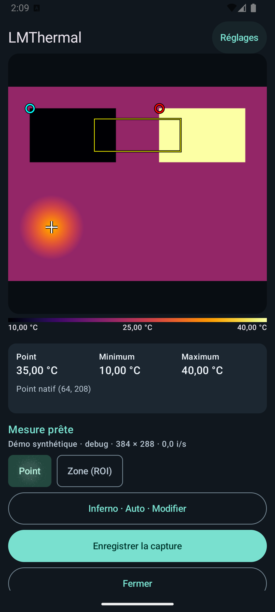
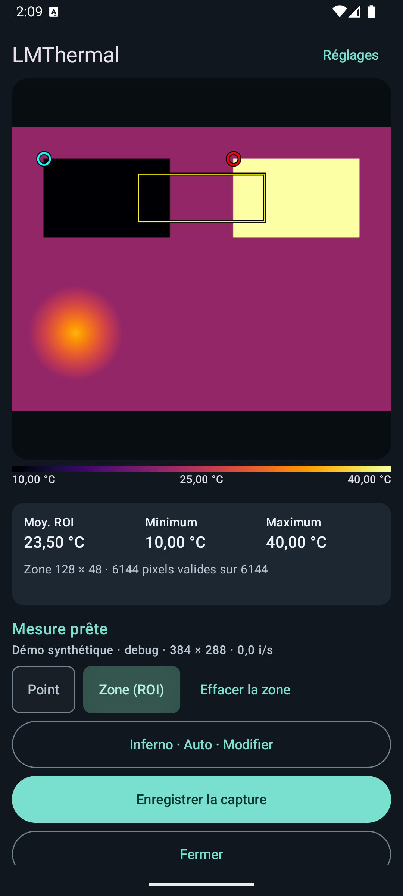
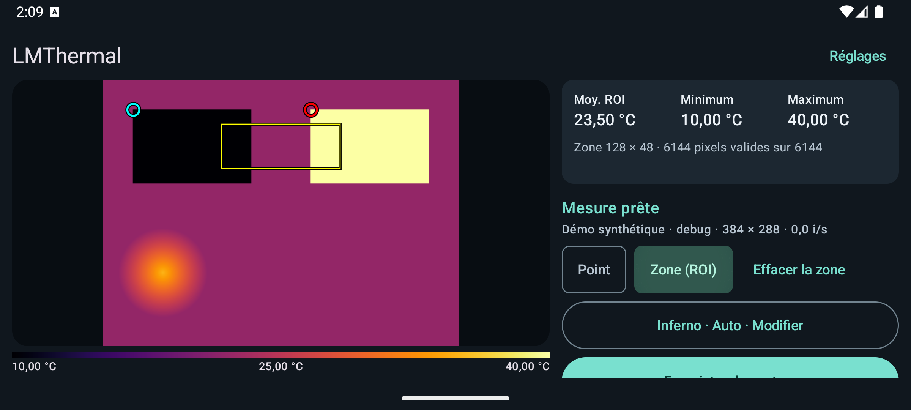
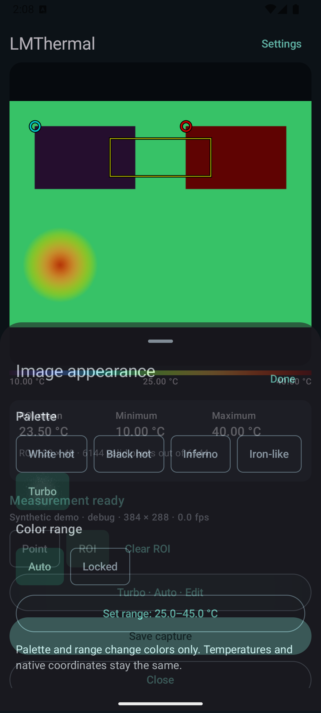
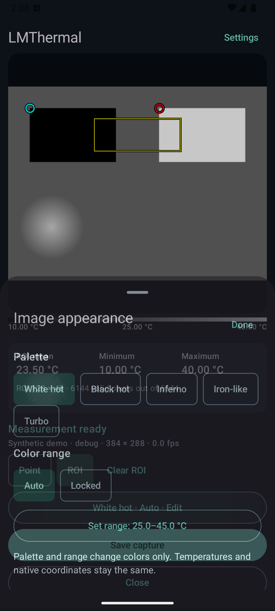
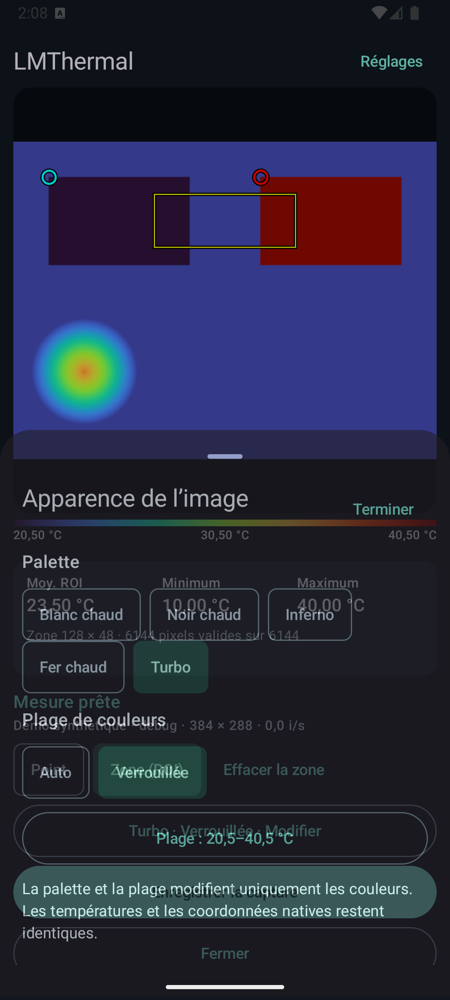
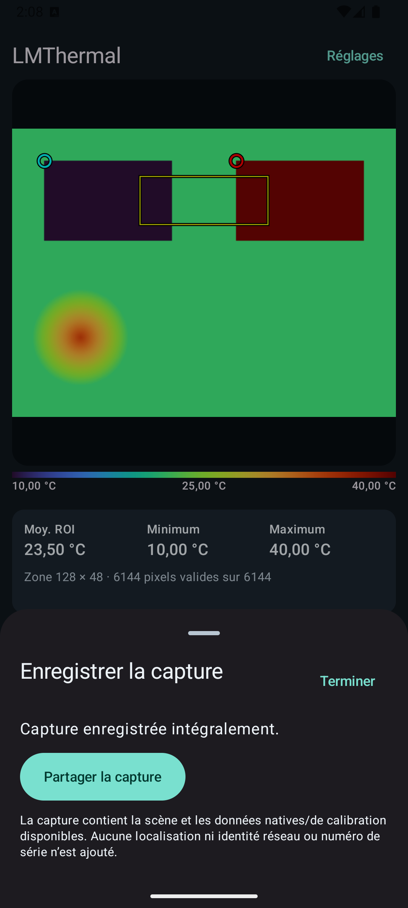
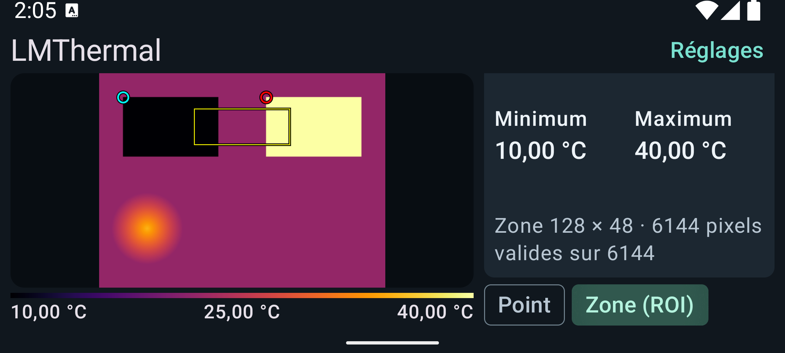
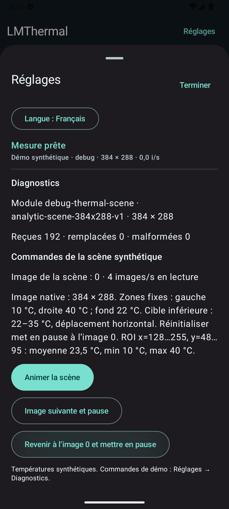

# Synthetic UX acceptance — principal Android app

Debug-only interactive follow-up to UX V1 / PR #19. All images below are real
API 36 emulator screenshots of the principal application, with deliberately
synthetic native 384×288 data. The earlier [before/after gallery](../ux-v1/README.md)
remains available. [Launch and repeat the recipe](../ANDROID_SYNTHETIC_UX.md).

## Candidate and results

- Branch: `codex/android-ux-v1`, extending UX commit `a7d9bfe56241456120c71e6759b185a779e3900d`.
- Local candidate: `build/ux-synthetic/LMThermal-ux-v1-synthetic-debug.apk`.
- APK SHA-256: `ef0675616ddf70c78a28b30f762cd9eef4068668a5155d36c53afcb7ea1e764b`.
- 23 Android JVM tests passed, including two debug scene/isolation oracles.
- Three synthetic device scenarios passed in English and French at normal font
  size, and in French at 200%: **9 successful scenario executions**.
- Four existing `ThermalWorkspaceDeviceTest` product UI regressions passed.
- Debug/test/unsigned release builds and lint passed: **0 errors, 12 existing warnings**.
- Debug/release APK isolation, main/debug EN/FR parity (119 + 10 keys), ten
  localization checker self-tests, camera boundaries and diff checks passed.
- Only `emulator-5554` (API 36, 1080×2400, 420 dpi) was targeted. Font size was
  restored to 1.0. No phone/camera, ADB restart, AVD clearing or R4 campaign.

[Full inventory and validation results](results.json), raw receipts:
[English](en-instrumentation.txt), [French](fr-instrumentation.txt),
[French 200%](fr-font200-instrumentation.txt), [product regressions](product-regression.txt).
Assertions and independent values: [measurements](fr-measurements.json),
[capture](fr-capture.json). The full generated set, including five palettes per
locale and actual synthetic `.lmtx` copies, is retained under `build/ux-synthetic`;
the selected screenshots below are committed for review.
The existing debug exporter also confirmed that the actual provider readback
matched each finalized archive: [SAF readback receipt](saf-readback.txt).

## Point and ROI

Frame-zero lower target: **35.00 °C**; global minimum **10.00 °C**, maximum **40.00 °C**.

Reference ROI: **23.50 °C mean**, **10.00 °C minimum**, **40.00 °C maximum**,
**6,144 pixels**, native bounds x=[128,256), y=[48,96). Rotation retains the
same ViewModel, session, paused measurement and native rectangle.

## Colors, ranges and capture

All five palettes are tested through their actual buttons. Colors change while
the reference values and native ROI remain identical. Two representative palettes:

Manual bounds accept decimal commas (20.5…40.5 °C); automatic range returns to
10…40 °C. The ROI readings do not change with the color range.

The system document picker really saved the capture. The test reopens/checks the
archive and compares every native Float32 word to the frozen source after a newer
live frame and Activity recreation. Provenance stays `simulated`.

## Large text and demo controls

At 200% fonts, the command/readout area scrolls while the image stays fixed.
This screenshot is scrolled to the ROI controls; scroll upward for its mean.

The debug scene's pause, step and reset controls remain in the existing secondary
Settings panel, with localized numerical references.

## Findings and limits

No functional anomaly was detected by this acceptance. The initial empty demo
viewport still displays the normal product USB hint; its model label identifies
the synthetic source and Connect does not touch USB. Large-text control scrolling
is expected and does not move the image during a held ROI gesture.

The prior UX baseline observed host emulator graphics crashes. No emulator restart
or crash interrupted this synthetic campaign. These results do not qualify real
HT-301 behavior/accuracy, manual TalkBack use, or external/cloud SAF providers.
The tested provider is the emulator's local Android DocumentsUI destination.
