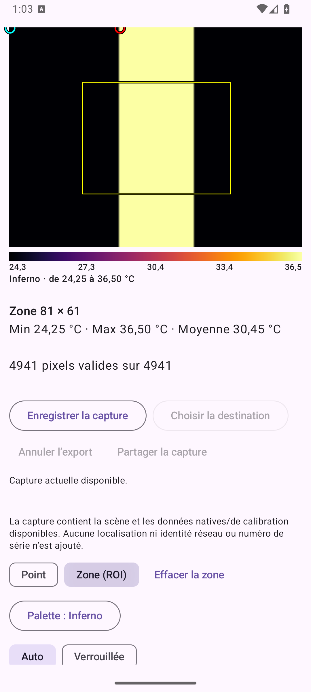
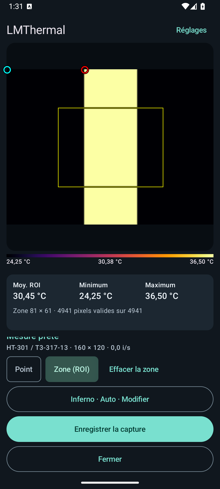
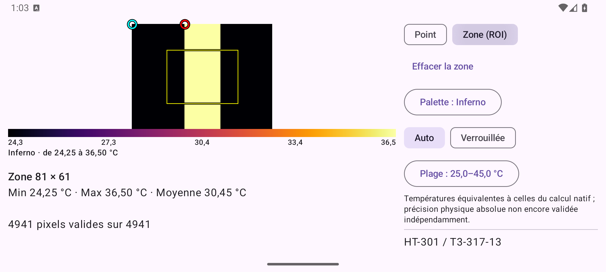
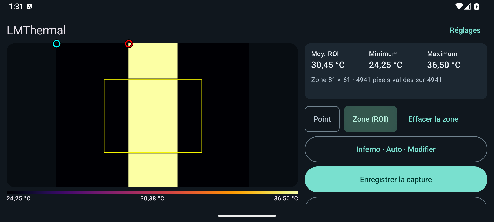
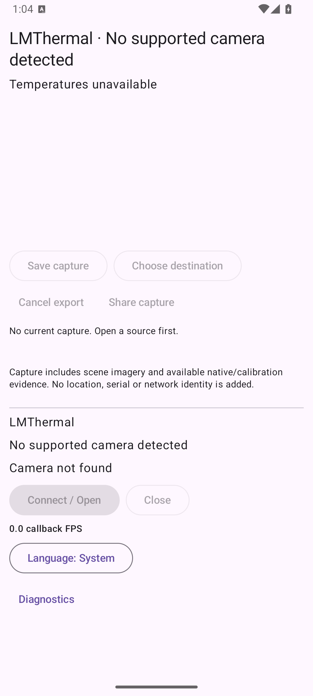
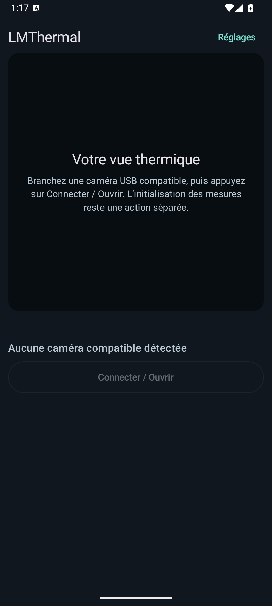
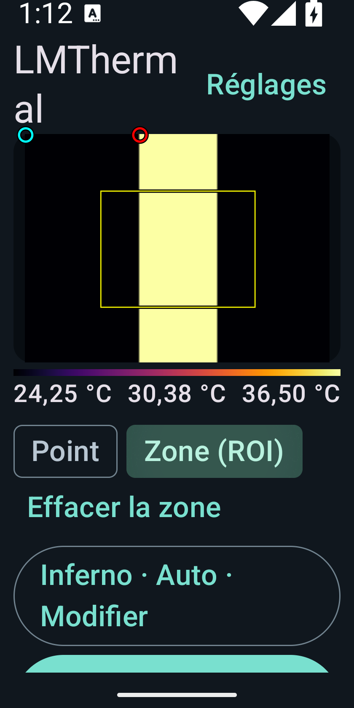
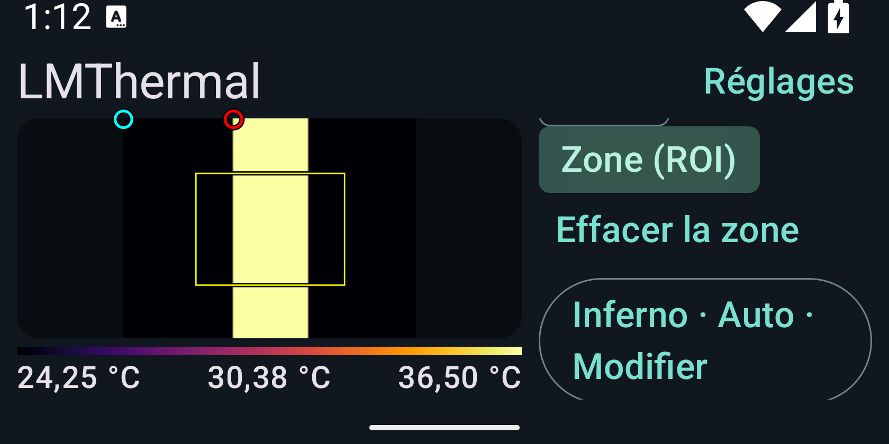

# Workspace V1 — emulator review

Principal application: `org.lmthermal.app`. Baseline: `main` at
`8eb4aceaf8bb36a8061c932b3121f898b81b4af3`. Candidate branch:
`codex/android-ux-v1`. All images are direct API 36 emulator screenshots.
The thermal scene is **synthetic test data** (160×120, two temperatures), not an
HT-301 capture and not evidence of physical accuracy. The HT-301 resource binding
is deliberately exercised by the synthetic layout test.

## Before and after

| Layout | Before | Workspace V1 |
|---|---|---|
| French portrait / ROI |  |  |
| French landscape / ROI |  |  |
| No camera (baseline English, candidate French) |  |  |

The baseline and candidate use the same synthetic scene and native ROI. Normal
runs use the AVD's original 1080×2400 px / 420 dpi display (approximately
411×914 dp before system insets). Scroll positions reflect the controls exercised
by the test, not a fabricated composite.

The image now stays visible while commands scroll, and normal-size temperature
summaries remain pinned. The old long command/export/status page is replaced by
focused panels. The exact native ROI remains `[40,121) × [30,91)` in both layouts.

## Enlarged text and small display

The same existing API 36 AVD was temporarily set to 840×1680 px / 420 dpi
(320×640 dp) and Android font scale **2.0**. French, English, expanded en-XA and
RTL ar-XB each pass in portrait and landscape. Controls can scroll independently
while the fitted image stays fixed; at this text size the metrics participate in
that scrolling so actions remain reachable. Original display size/font scale are
restored after testing.

| Portrait | Landscape |
|---|---|
|  |  |

## Validation scope

- 232 core JVM tests and 21 Android JVM tests: passed.
- Principal debug APK and test APK: built; both arm64-v8a and x86_64 native libraries
  verified in the principal APK. Release remains arm64-v8a.
- Lint: zero errors, 12 warnings on existing target/dependency/manifest/release-ABI
  configuration; no new unused-resource warnings retained.
- Translation checker: 119 English / 119 French resources and ten checker self-tests
  passed. Shared camera boundary checker and `git diff --check` passed.
- Focused final API 36 instrumentation: see `results.json` for the exact class list,
  counts, artifact hash and large-font run. Tests use only synthetic/test sources.
- Baseline locale/orientation/ROI test passed before changes; candidate repeats the
  eight-layout matrix at normal and enlarged font sizes, including held-pointer
  geometry stability, measurement gaps/recovery, capture preparation/cancellation,
  palette/range controls and secondary-panel reachability.

No Pixel 8 or HT-301 was used. No R4 campaign, source/USB/thermometry change,
production LMTR recording, Desktop change or physical accuracy claim is included.
The emulator process also exhibited graphics-related SIGSEGVs outside the successful
test runs (see the UX guide); indefinite emulator stability is not claimed.
Real camera UX, system/provider-specific behavior and TalkBack gesture ergonomics
remain follow-up checks requiring appropriate hardware/operator authorization.

## Try the candidate

The ignored local artifact is `build/ux-v1/LMThermal-ux-v1-debug.apk` in this
worktree, copied from the verified principal debug APK. It is a debug-signed
candidate, not a release package. The APK is not committed to Git.

```bash
adb -s emulator-5554 shell getprop ro.build.version.sdk
adb -s emulator-5554 install -r build/ux-v1/LMThermal-ux-v1-debug.apk
adb -s emulator-5554 shell am start -n org.lmthermal.app/.MainActivity
```

Use the actual emulator serial if it differs. Full build/test commands and the
product workflow are in [ANDROID_UX_V1.md](../ANDROID_UX_V1.md).
